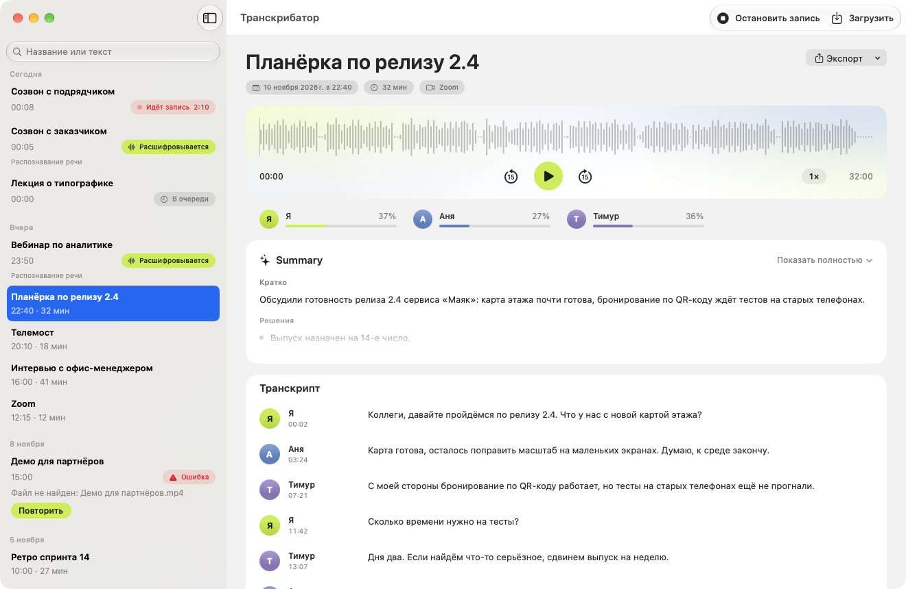

# Транскрибатор встреч

Программа для Mac «Транскрибатор»: окно со всеми встречами и значок в строке меню. Она сама замечает, что начался созвон (Zoom, Google Meet, Яндекс.Телемост, Контур.Толк, Teams, Slack, Telegram и др.), записывает ваш микрофон и звук собеседников, а после встречи локально расшифровывает запись, делит речь по спикерам и просит Claude Code сделать краткое summary. Ботов в созвоне нет, звук никуда не отправляется. В Claude уходит только текст для summary.

Результат — папка `~/transcripts/<ГГГГ-ММ-ДД ЧЧ-ММ> <Приложение>/` с `meeting.md` (summary и транскрипт с таймкодами) и аудио `mic.m4a`, `system.m4a`.



Ещё снимки, в светлой и тёмной теме, — в `docs/screenshots/`: встреча, обработка по этапам, запись, перетаскивание файла.

## Что нужно

- macOS 26 или новее, Apple Silicon.
- Command Line Tools (`xcode-select --install`). Xcode не нужен.
- [uv](https://docs.astral.sh/uv/) и `ffmpeg` (`brew install uv ffmpeg`).
- Claude Code (`claude`), вход по подписке. Summary делает `claude -p`.
- Доступ к модели `pyannote/speaker-diarization-community-1` на Hugging Face. Токен должен лежать в `~/.cache/huggingface/token` (`hf auth login`).

## Установка

```sh
make install
```

Команда:
1. ставит Python-окружение (`uv sync`, папка `.venv` в проекте);
2. собирает `build/MeetingTranscriber.app`;
3. копирует его в `~/Applications`;
4. пишет `~/.config/meeting-transcriber/config.json` с абсолютными путями к `claude` и `.venv/bin/python`;
5. включает автозапуск при входе: LaunchAgent `ru.local.meeting-transcriber`. При входе в систему программа стартует без окна (`--background`), только со значком в строке меню.

Если `make install` запустить повторно, приложение обновится. Ваши настройки в `config.json` сохранятся, перезапишутся только пути.

Модели (Whisper, около 1.6 ГБ) скачиваются при первой обработке. Поэтому первая встреча обрабатывается дольше.

## Разрешения

При первом запуске macOS спросит два разрешения. Дайте оба:

- **Микрофон** — чтобы записывать ваш голос.
- **Запись экрана и системного аудио** — чтобы записывать звук собеседников. Экран программа не записывает: ScreenCaptureKit требует это разрешение для захвата звука.

Если доступа нет, в меню появится пункт **«Нет доступа: открыть настройки»**, и программа не будет делать вид, что пишет. После того как выдадите разрешение на запись экрана, перезапустите программу: «Выход» в меню, затем откройте `~/Applications/MeetingTranscriber.app`.

Приложение подписано ad-hoc. Поэтому после каждой пересборки или переустановки (`make app`, `make install`) macOS может заново спросить доступ к микрофону и к записи экрана и системного аудио — или молча считать его выключенным. Тогда снова дайте оба разрешения (при необходимости выключите и включите переключатель MeetingTranscriber в «Системные настройки → Конфиденциальность и безопасность») и перезапустите программу.

## Как пользоваться

### Окно

Окно открывается из Dock, из «Программ» (программа называется «Транскрибатор») и пунктом меню «Открыть Транскрибатор». Если закрыть окно, программа продолжит работать в строке меню.

- **Список слева** — встречи по дням, со статусом: «Идёт запись», «В очереди», «Расшифровывается», «Ошибка». Поиск ищет по названию и по тексту реплик. Клик по найденному фрагменту открывает встречу на этом месте.
- **Встреча** — плеер с волной (пробел — пуск и пауза, ±15 секунд, скорость), карточка спикеров с долей речи, summary и транскрипт. Клик по реплике включает запись с этого места. Название встречи меняется двойным кликом, имя спикера — кликом по нему. Правки хранятся в `user.json` в папке встречи и переживают повторную обработку.
- **Загрузка файла** — перетащите видео или аудио в любое место окна или нажмите «Загрузить» в тулбаре. Можно несколько файлов сразу: первый обрабатывается, остальные ждут в очереди. Если файл не аудио и не видео, окно скажет об этом и встречу не создаст.
- **Обработка** — на экране встречи видны четыре шага: «Извлечение звука → Распознавание речи → Спикеры → Summary». Если обработка упала, виден шаг, на котором она остановилась, текст ошибки и кнопка «Повторить». Если не получилось только summary, встреча открывается с транскриптом и кнопкой «Сделать summary».
- **Запись** — у встречи, которая сейчас пишется, на экране таймер и живая волна от громкости микрофона.
- **Экспорт** — меню «Экспорт» на экране встречи: Markdown, Word (DOCX), PDF и «Копировать текст». В файл попадают название, дата, длительность, summary и транскрипт с вашими именами спикеров.

Если в macOS включено «Уменьшение движения», анимации заменяются простым проявлением.

### Строка меню

По умолчанию запись включается вручную: в начале встречи нажмите значок 🎙 → «Начать запись». Остановится она сама, когда встреча закончится, или по «Остановить запись».

- 🎙 — программа ждёт.
- 🔴 12:34 — идёт запись. Если включить «Записывать автоматически», запись начинается сама, когда приложение для созвонов (Zoom, Teams, Телемост, Толк, FaceTime…) держит микрофон 5 секунд. Браузеру, Telegram, Slack и Discord одного микрофона мало: нужно ещё открытое окно созвона («Meet –», «Телемост», «Толк», «Microsoft Teams»), поэтому голосовые сообщения, голосовой ввод и программы для диктовки запись не запускают. Звонки в Telegram, Slack и Discord записывайте вручную.
- ⏳ — запись расшифровывается. По готовности придёт уведомление «Встреча расшифрована». Если нажать на уведомление, встреча откроется в окне.
- Если расшифровка удалась, а Claude summary не сделал (таймаут, нет сети, не выполнен вход), придёт уведомление «Встреча расшифрована, но summary не получилось — Меню → Повторить summary». Транскрипт в `meeting.md` при этом уже есть.

Запись останавливается сама, если 90 секунд подряд нет признаков встречи: никто из списка не держит микрофон и нет окна встречи («Zoom Meeting», «Meet –», «Телемост», «Толк»). Если вы выключили микрофон в созвоне, запись продолжается, пока окно встречи открыто.

Пункты меню:

| Пункт | Что делает |
|---|---|
| Открыть Транскрибатор | Открывает окно. |
| Начать / Остановить запись | Записать любую встречу вручную или остановить текущую. Встреча, остановленная вручную, сама заново не начнётся: автозапись снова включится, только когда признаков встречи не будет 30 секунд подряд. |
| Загрузить аудио или видео… | Расшифровать готовый файл (mp4, mov, mp3, m4a, wav и др., можно несколько сразу). Звук из файла идёт в ту же обработку, что и запись: текст, спикеры, summary. Исходный файл остаётся на месте, в папке встречи сохраняется только `system.m4a`. Не перемещайте файл, пока он не обработан. |
| Записывать автоматически | Включает автостарт (по умолчанию выключен). Состояние запоминается. |
| Последние встречи ▸ | 5 последних встреч, открываются в окне. |
| Повторить summary (последняя встреча) | Заново делает summary без повторной расшифровки, например если Claude не ответил. |
| Открыть папку транскриптов | Открывает `~/transcripts` в Finder. |
| Выход | Корректно закрывает запись. Встреча обработается при следующем запуске. |

Записи короче 15 секунд удаляются. Если программа упала или вы вышли посреди записи, при следующем запуске встреча обработается автоматически. Пока обрабатывается одна встреча, можно записывать следующую: обработка идёт в очереди по одной.

## Настройки

`~/.config/meeting-transcriber/config.json` (ключ, которого нет, получает значение по умолчанию):

| Ключ | По умолчанию | Что это |
|---|---|---|
| `outputDir` | `~/transcripts` | куда складывать встречи |
| `language` | `ru` | язык расшифровки |
| `claudePath` | путь из установки | `claude` для summary |
| `pythonPath` | `<проект>/.venv/bin/python` | Python для обработки |
| `summaryTimeoutSec` | `300` | сколько ждать summary |
| `extraBundleIDs` | `[]` | дополнительные приложения для созвонов, например `["org.jitsi.jitsi-meet"]` |
| `extraTitlePatterns` | `[]` | дополнительные шаблоны заголовков окон встречи |

Bundle ID приложения можно узнать командой `osascript -e 'id of app "Имя"'`. Ещё один способ — включить созвон и выполнить проверку из раздела «Отладка». После правки настроек перезапустите программу.

## Обработка вручную

Любую папку встречи можно обработать без приложения. Код выхода: 0 — готово, 2 — транскрипт готов, но summary не получилось (по нему приложение показывает уведомление «Повторить summary»), 1 — ошибка:

```sh
.venv/bin/python -m transcriber process "~/transcripts/2026-10-23 14-05 Zoom"
.venv/bin/python -m transcriber resummarize "~/transcripts/2026-10-23 14-05 Zoom"
```

## Отладка

- Кто сейчас держит микрофон и какие окна встреч видны: `~/Applications/MeetingTranscriber.app/Contents/MacOS/MeetingTranscriber --probe`. Чтобы смотреть непрерывно, раз в 2 с с событиями детектора, добавьте `--watch`.
- Журнал обработки: `~/Library/Logs/MeetingTranscriber/processing.log`. Если обработка упала, текст ошибки лежит в `error.txt` в папке встречи.

## Демо-режим и скриншоты

Чтобы показать программу, не открывая свои разговоры, запустите её с `--demo`. Она покажет выдуманные встречи из временной папки, сама проиграет запись и обработку и не тронет микрофон, очередь и `~/transcripts`:

```sh
build/MeetingTranscriber.app/Contents/MacOS/MeetingTranscriber --demo
```

Скриншоты из `docs/screenshots/` программа снимает сама: открывает окно, по очереди в светлой и тёмной теме снимает встречу, обработку, запись и перетаскивание и выходит. Ключ работает только вместе с `--demo`. Терминалу, из которого запущена команда, нужен доступ «Запись экрана».

```sh
build/MeetingTranscriber.app/Contents/MacOS/MeetingTranscriber --demo --screenshots docs/screenshots
```

## Удаление

```sh
make uninstall
```

Команда снимает автозапуск и удаляет приложение из `~/Applications`. Настройки и встречи остаются на месте.

## Разработка

| Команда | Что делает |
|---|---|
| `make setup` | Python-окружение (`uv sync`) |
| `make app` | собрать `build/MeetingTranscriber.app` |
| `make check` | тесты: `uv run pytest` и `cd app && swift run selftest` |
| `cd app && swift build` | собрать Swift-часть |
